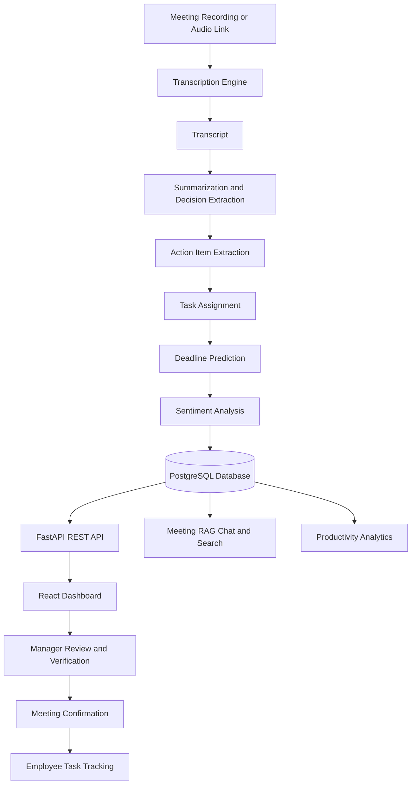

# 🎙️ AI Meeting Assistant — Meeting Intelligence Platform

An AI-powered meeting intelligence platform that transforms meeting recordings into structured summaries, decisions, actionable tasks, and productivity insights. Built with **React, FastAPI, PostgreSQL, and LLM-powered workflows**, it helps teams turn conversations into measurable outcomes.

## ✨ Overview

Meetings often generate valuable information, but important decisions, action items, task owners, and deadlines can easily get lost. The AI Meeting Assistant automates this process by analyzing meeting recordings and presenting the results in a centralized, interactive dashboard.

Managers can review and verify AI-generated outputs before confirming a meeting, while employees can track their assigned tasks and report progress.

### Key Highlights

- 🎙️ **Meeting Transcription:** Convert meeting recordings into text using Whisper or Sarvam.
- 📝 **AI Summarization:** Generate concise meeting summaries, decisions, and key discussion points.
- ✅ **Action Item Extraction:** Identify tasks, potential owners, priorities, and deadlines.
- 🤖 **Intelligent Task Assignment:** Suggest task owners when they cannot be identified directly.
- 📅 **Deadline Prediction:** Estimate missing deadlines using contextual heuristics or LLM-powered logic.
- 💬 **Meeting-Specific RAG Chat:** Ask questions about a particular meeting using its stored transcript.
- 🔎 **AI-Powered Search:** Search across meetings using keywords and optional LLM-based reranking.
- 🎧 **Live Browser Recording:** Record supported browser-tab or screen audio, or microphone audio, and upload it for processing.
- 😊 **Sentiment Analysis:** Classify meeting sentiment as positive, neutral, or negative.
- 📊 **Productivity Analytics:** Explore task completion and employee or team productivity indicators.
- 🔐 **Authentication and Multi-Tenancy:** Separate company data using company-scoped records and protected API endpoints.
- 📧 **Email Notifications:** Support meeting-confirmation and task-reminder email workflows.
- 🎤 **Voice Search:** Transcribe spoken queries and use the same search pipeline as text search.

---

## 🏗️ Architecture



The existing transcription, summarization, extraction, database, and utility modules are retained. The new backend API layer and React frontend extend the existing pipeline with task management, authentication, analytics, and interactive meeting workflows.

## 🛠️ Tech Stack

| Layer | Technologies |
|---|---|
| Frontend | React, Vite, Tailwind CSS, Recharts |
| Backend | Python, FastAPI |
| Database | PostgreSQL, SQLAlchemy |
| AI & NLP | Whisper / Sarvam, LLM integration, RAG, heuristic fallbacks |
| Authentication | JWT, bcrypt password hashing |
| API Communication | REST APIs, HTTP client |
| Recording | Browser MediaRecorder API |
| Development Tools | Git, GitHub, Postman, VS Code |

*Exact model providers and optional integrations depend on the project's environment configuration.*

---

## 🚀 Features in Detail

### 1. Meeting Processing Pipeline

Submit a supported meeting recording or audio link to initiate the processing workflow.

1. Transcribe the recording into text.
2. Generate a meeting summary and extract key decisions.
3. Extract action items from the transcript.
4. Suggest owners for tasks with missing assignments.
5. Predict missing deadlines where possible.
6. Analyze meeting sentiment.
7. Save the processed information for review and further interaction.

The pipeline reuses the existing core modules and extends them with additional AI-assisted processing.

### 2. Manager Review and Verification

AI-generated information should be reviewed before it becomes an authoritative record.

Managers can:

- Edit the generated meeting title.
- Review and correct task owners, deadlines, and priorities.
- Verify individual action items.
- Confirm a meeting after all required tasks have been verified.
- Receive a meeting-confirmation email when email delivery is configured.

Processed meetings enter a pending-review state, supporting a human-in-the-loop workflow.

### 3. Employee Task Tracking

Employees can view their assigned tasks and report progress. Managers have additional permissions to edit and verify task details.

This separates AI-generated suggestions from reviewed assignments and makes task ownership easier to track.

### 4. Meeting-Specific RAG Chat

Ask questions about an individual meeting, such as:

- What decisions were made?
- What tasks were assigned to me?
- Which deadlines were discussed?
- What blockers or unresolved questions were mentioned?

The chat uses the selected meeting's stored transcript as its retrieval context, helping keep answers focused on the relevant meeting.

### 5. AI Search and Voice Search

Search meeting information through text or voice.

- Text search supports keyword matching and optional LLM-based reranking.
- Voice search transcribes spoken queries before passing them through the search pipeline.
- Search results help users locate relevant information across stored meetings.

### 6. Analytics and Sentiment

The dashboard provides productivity indicators and meeting sentiment analysis. A transparent 0–100 scoring mechanism is used to represent employee or team productivity based on the implemented scoring logic.

These indicators are intended to support workflow visibility rather than serve as definitive measures of individual performance.

### 7. Authentication and Multi-Tenancy

The application is designed around company-scoped data and role-based permissions.

- **Managers:** Review meetings, verify tasks, manage meeting details, and access company invite information.
- **Employees:** View assigned tasks and update their own progress.
- **Company isolation:** Company-owned records include a `company_id`, and database queries are intended to enforce tenant boundaries.
- **Protected routes:** Authentication dependencies protect backend endpoints, while the frontend redirects unauthenticated users to the login page.

Signup supports company creation or joining through an invite code, with domain-based company matching where configured.

> **Security note:** Multi-tenancy and role-based access are design goals that must be verified through authorization tests, including attempts to access another company's records. Client-side route protection alone is not a security boundary.

---

## 📁 Project Structure

```text
AI-Meeting-Assistant/
├── backend/
│   ├── app.py
│   ├── auth.py
│   ├── db_models.py
│   ├── core_ext/
│   │   ├── sentiment_analyzer.py
│   │   ├── task_assigner.py
│   │   ├── deadline_predictor.py
│   │   ├── search_engine.py
│   │   ├── productivity_scorer.py
│   │   ├── email_service.py
│   │   └── llm_adapter.py
│   ├── routers/
│   │   ├── auth.py
│   │   ├── meetings.py
│   │   ├── tasks.py
│   │   ├── search.py
│   │   ├── analytics.py
│   │   ├── employees.py
│   │   └── ...
│   └── requirements.txt
├── frontend/
│   ├── src/
│   │   ├── api/
│   │   ├── auth/
│   │   ├── components/
│   │   ├── pages/
│   │   └── ...
│   ├── package.json
│   └── ...
├── core/
│   ├── transcriber.py
│   ├── summarizer.py
│   ├── extractor.py
│   └── rag_engine.py
├── database/
│   └── save_data.py
├── utils/
├── main.py
├── .env.example
└── README.md
```

*The tree illustrates the intended organization; filenames and modules may vary slightly depending on the current repository version.*

---

## ⚙️ Getting Started

### Prerequisites

Install the following before running the project:

- Python 3.10 or a compatible version required by your dependencies
- Node.js and npm
- PostgreSQL
- Git
